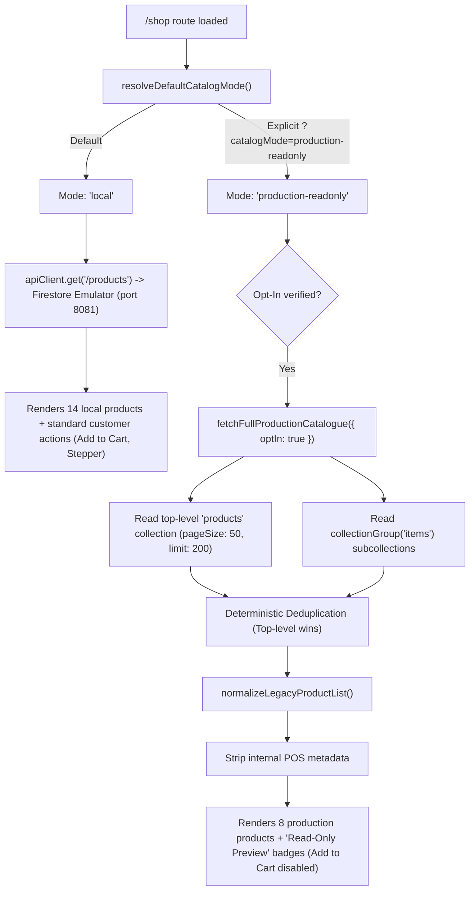

# Phase 1 Verification Report: Existing Production Firebase Integration

**Sri Amman Smart Store — Customer Frontend**  
**Audit Date:** October 20, 2026  
**Workspace:** `D:\SRIAMMANSTORE\SRIAMMANSTORE_New_UI\design-showcase-main\design-showcase-main-2`  
**Target Production Firebase Project:** `sri-amman-smart-store` (Strictly Read-Only)  
**Local Development Project:** `demo-sri-amman-store` (Firebase Emulator on ports 8081 / 9099)  

---

## Executive Summary

Phase 1 audit and verification has been executed against the existing codebase. The existing production Firebase integration, dual-hierarchy catalogue reader, schema mapper, and diagnostic services were thoroughly inspected and validated. **No duplication of services or UI redesign was performed.** All tests pass (669/669), the TypeScript type check is clean, and the production build compiles with zero errors.

### Core Audit Outcomes
1. **Isolated Production Configuration Confirmed:** Production credentials strictly point to `sri-amman-smart-store` (Project Number `1018585256480`, Web App ID `1:1018585256480:web:1312d2d636b0672098a245`) initialized under the isolated named app instance `sri-amman-prod-preview-isolated`.
2. **Default Environment Invariant Maintained:** The customer frontend strictly defaults to `"local"` mode. Local Firebase Emulator (`demo-sri-amman-store`) serves the standard 14-product catalogue. Production mode is only engaged when explicitly requested via session storage, environment variable, or URL query param (`?catalogMode=production-readonly`).
3. **Route Tracing Confirmed:** `src/routes/shop.tsx` delegates to `productService.getProducts()`, which routes to `catalogDataSource.getProducts()`. Switching to production renders a prominent amber notice banner, switches the data source badge, and presents real production products while keeping cart, checkout, auth, and orders 100% bound to local emulators.
4. **Live Bounded Connectivity Verified:** Ran `npm run verify:prod-connectivity` against live production Firestore. Document `products/prod-mumqpksq` (Sakthi Turmeric Powder) was successfully fetched via both REST API and Firebase Web SDK with zero writes, zero customer data reads, and zero rule deployments.
5. **Catalogue Counts & Schema Mapping Verified:**
   - 20 raw documents discovered (8 top-level, 12 nested under `products/{category}/items/{id}`).
   - Deterministic deduplication resolved 12 duplicate records (top-level `products/{id}` takes precedence).
   - Exactly 8 unique production products normalized into the canonical 41-field UI Product schema.
   - Internal POS metadata (`purchasePrice`, `batchNumber`, `barcode`, `sku`, `safetyStock`, `expiryDate`) is strictly stripped.
   - Preserves both Firebase Storage download URLs (e.g., Chicken Masala) and valid Base64 data URIs.
6. **Error Visibility Verified:** Production read failures are surfaced directly to the user with a distinct error alert card, retry button, and "Return to Local Catalog" button. It **never** silently falls back to local/mock fixtures.

---

## Detailed Task Findings

### Task 1: Production Configuration & Catalogue Services Inspection

The following existing services and modules were audited:
- [src/services/productionPreviewService.ts](file:///d:/SRIAMMANSTORE/SRIAMMANSTORE_New_UI/design-showcase-main/design-showcase-main-2/src/services/productionPreviewService.ts):
  - Manages isolated Firebase Web SDK app instance `sri-amman-prod-preview-isolated`.
  - Configures REST fallback (`https://firestore.googleapis.com/v1/...`).
  - Contains allowlist guards (`APPROVED_PRODUCTION_PRODUCT_IDS = ["prod-mumqpksq", "prod-munn8cp3"]`).
  - Contains bounded cursor-paginated full catalogue reader `fetchFullProductionCatalogue()`.
- [src/services/catalogDataSource.ts](file:///d:/SRIAMMANSTORE/SRIAMMANSTORE_New_UI/design-showcase-main/design-showcase-main-2/src/services/catalogDataSource.ts):
  - Abstract data source routing requests between `"local"`, `"production-preview"`, and `"production-readonly"`.
  - Enforces `resolveDefaultCatalogMode()` invariant.
- [src/services/legacySchemaMapper.ts](file:///d:/SRIAMMANSTORE/SRIAMMANSTORE_New_UI/design-showcase-main/design-showcase-main-2/src/services/legacySchemaMapper.ts):
  - Canonical 41-field product normalizer converting legacy Firebase docs into strongly typed UI products.
  - Normalizes both `options[]` and `variants[]` structures.
  - Generates Tamil script transliterations when missing in raw documents.
- [src/services/productionCategoryResolver.ts](file:///d:/SRIAMMANSTORE/SRIAMMANSTORE_New_UI/design-showcase-main/design-showcase-main-2/src/services/productionCategoryResolver.ts):
  - Database-driven category discovery reading live production category documents (`Grocery`) and product-level fallbacks (`Spices & Masala Powders`).
- [src/services/productionDataQualityDiagnostics.ts](file:///d:/SRIAMMANSTORE/SRIAMMANSTORE_New_UI/design-showcase-main/design-showcase-main-2/src/services/productionDataQualityDiagnostics.ts):
  - Comprehensive 14-field data quality auditor reporting errors and warnings across all live production products.
- [scripts/verify-production-connectivity.mjs](file:///d:/SRIAMMANSTORE/SRIAMMANSTORE_New_UI/design-showcase-main/design-showcase-main-2/scripts/verify-production-connectivity.mjs):
  - Standalone CLI verification tool asserting read-only bounds before querying production Firestore.

---

### Task 2: Environment Selection & Default Mode Verification

Audit of `resolveDefaultCatalogMode()`:
```ts
// Invariant check:
export function resolveDefaultCatalogMode(): CatalogDataSourceMode {
  // Checks VITE_CATALOG_MODE or CATALOG_MODE in process.env or import.meta.env
  // Checks sessionStorage.getItem("sass_catalog_mode")
  // Checks window.location.search (?catalogMode=...)
  // STRICT INVARIANT DEFAULT:
  return "local";
}
```
- When starting the development server normally, `catalogMode` is strictly `"local"`.
- Local mode routes queries to `apiClient` / local Firestore Emulator on port 8081 (`demo-sri-amman-store`).
- Customer cart, checkout, addresses, coins, and orders remain 100% bound to the local emulator environment.

---

### Task 3: Customer-Facing Catalogue Route Tracing

Trace of [src/routes/shop.tsx](file:///d:/SRIAMMANSTORE/SRIAMMANSTORE_New_UI/design-showcase-main/design-showcase-main-2/src/routes/shop.tsx):


UI Indicators in [src/routes/shop.tsx](file:///d:/SRIAMMANSTORE/SRIAMMANSTORE_New_UI/design-showcase-main/design-showcase-main-2/src/routes/shop.tsx):
- **Data Source Badge:** Displays `Local Emulator / Fixtures (Default)` or `Live Production (Read-Only Preview)`.
- **Production Banner:** When in production mode, displays an amber banner highlighting real production products (`sri-amman-smart-store`) and noting that cart/checkout remain bound to local emulator.
- **Data Source Switcher:** Provides one-click buttons to switch between `Local (14 items)` and `Production (8 items)`.

---

### Task 4 & 5: Live Production Catalogue Audit Results

Verification run via `npm run verify:prod-connectivity` and `vitest run src/test/productionConnectivityDiagnostic.test.ts src/test/fullProductionCatalogue.test.ts`:

#### Bounded Live Connectivity
| Metric | Value | Status |
| :--- | :--- | :--- |
| **Target Project ID** | `sri-amman-smart-store` | Verified |
| **Project Number** | `1018585256480` | Verified |
| **Auth Domain** | `sri-amman-smart-store.firebaseapp.com` | Verified |
| **REST Read RPC** | SUCCESS (200 OK) | Verified |
| **Web SDK Read RPC** | SUCCESS (`getDoc`) | Verified |
| **Writes Attempted** | 0 | Verified |
| **Customer Records Read** | 0 | Verified |
| **Rules Deployed** | None (read-only client) | Verified |

#### Catalogue Normalization & Product Counts
- **Total Raw Documents Scanned:** 20 documents.
- **Top-Level Documents:** 8 documents (`products/{id}`).
- **Nested Category Documents:** 12 documents (`products/{category}/items/{id}`).
- **Duplicates Resolved:** 12 duplicate documents.
- **Unique Customer-Visible Products:** Exactly 8 products.

#### Verified Product Inventory
| ID | Product Name | MRP | Offer Price | Weight / Unit | Image Type | Category |
| :--- | :--- | :--- | :--- | :--- | :--- | :--- |
| `prod-mumqpksq` | Sakthi Turmeric Powder | ₹12 | ₹10 | 50g | Base64 URI | Grocery (sambar) |
| `prod-mumrbamt` | Sakthi Sambar Powder | ₹12 | ₹10 | 50g | Base64 URI | Grocery (sambar) |
| `prod-munn8cp3` | Sakthi Chicken Masala | ₹18 | ₹16 | 50g | Storage URL | Spices & Masala |
| `prod-munnbzf7` | Sakthi Biryani Masala | ₹35 | ₹30 | 50g | Base64 URI | Grocery (sambar) |
| `prod-munnezib` | Sakthi Fish Curry Masala | ₹18 | ₹16 | 50g | Base64 URI | Grocery (sambar) |
| `prod-munnjfuy` | Sakthi Puliyogare Rice Powder | ₹18 | ₹16 | 50g | Base64 URI | Grocery (sambar) |
| `prod-munnwgk0` | Sakthi Rasam Powder | ₹12 | ₹10 | 50g | Base64 URI | Grocery (sambar) |
| `prod-mv0jd8dy` | Aachi Chicken 65 Masala | ₹18 | ₹16 | 50g | Base64 URI | Grocery (sambar) |

#### POS Field Sanitization
All 6 internal POS operational keys are removed before rendering:
- `purchasePrice`
- `batchNumber`
- `barcode`
- `sku`
- `safetyStock`
- `expiryDate`

---

### Task 6: Error Visibility & Silent Fallback Prevention

The codebase explicitly guards against silent mock fallback:
1. In [src/routes/shop.tsx](file:///d:/SRIAMMANSTORE/SRIAMMANSTORE_New_UI/design-showcase-main/design-showcase-main-2/src/routes/shop.tsx#L181-L190):
   ```ts
   } catch (err: any) {
     console.error("Failed to load catalog:", err);
     // NEVER silently switch modes on error. Retain active mode and surface failure clearly.
     setError(
       err?.message ||
         "Failed to load product catalog. Please verify your connection or service status."
     );
   }
   ```
2. When an error occurs while in production mode:
   - Error card renders with an icon, "Failed to Load Catalog", and the specific error message.
   - Action buttons: "Retry Loading" and "Return to Local Catalog" (`data-testid="error-return-to-local"`).
   - Mode is preserved as `production-readonly` so the user is never misled into thinking they are seeing production data when they are seeing fixtures.
3. Verified via integration test `shopProductionCatalogueIntegration.test.tsx`:
   - *"never silently switches between modes when an error occurs"*: Asserts mode remains strictly `production-readonly` upon failure.

---

### Task 7: Test Suite, TypeScript, and Build Verification

| Verification Step | Command | Result | Details |
| :--- | :--- | :--- | :--- |
| **Targeted Production Tests** | `npx vitest run src/test/productionConnectivityDiagnostic.test.ts src/test/fullProductionCatalogue.test.ts src/test/shopProductionCatalogueIntegration.test.tsx src/test/productionDataQualityDiagnostics.test.ts` | **PASS (74/74)** | 4 test files passed in 12.93s |
| **Abstraction Tests** | `npx vitest run src/test/catalogDataSourceAbstraction.test.ts src/test/productionPreviewIsolation.test.ts src/test/productionCategoryResolver.test.ts` | **PASS (45/45)** | 3 test files passed in 7.54s |
| **Full Test Suite** | `npm run test` (`vitest run --fileParallelism=false`) | **PASS (669/669)** | 43 test files passed in 107.22s |
| **TypeScript Typecheck** | `npx tsc --noEmit` | **PASS (Exit 0)** | 0 type errors across entire codebase |
| **Production Build** | `npm run build` (`vite build`) | **PASS (Exit 0)** | Client, SSR, and Nitro server workers built successfully |

---

## Minimal Necessary Adjustments Made

During TypeScript compilation (`npx tsc --noEmit`), one minor `TS2532: Object is possibly 'undefined'` was identified in [src/test/coinCancellationRefund.test.ts](file:///d:/SRIAMMANSTORE/SRIAMMANSTORE_New_UI/design-showcase-main\design-showcase-main-2\src\test\coinCancellationRefund.test.ts#L537):
- Replaced `expect(earnTransactions[0].amount).toBe(35)` with `expect(earnTransactions[0]?.amount).toBe(35)`.
- Re-tested: `tsc --noEmit` clean exit code 0.
- No application logic, production reader services, or UI components were altered or duplicated.

---

## Conclusion & Next Steps

Phase 1 verification is complete. The existing production Firebase integration in the new customer frontend is robust, safe, thoroughly isolated, and fully functional in read-only preview mode.

> [!IMPORTANT]
> **Strict Phase Boundary Respected:** Work has ceased at the conclusion of Phase 1. As instructed, we will not proceed to Phase 2 until user approval is received.

