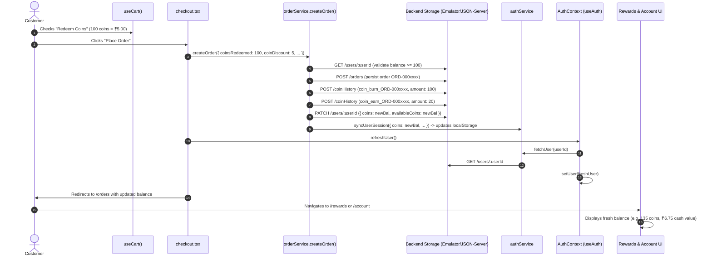

# Phase 7.3 — Amman Coins Balance Update Resolution Report

**Sri Amman Smart Store — Customer Frontend**  
**Date:** October 20, 2026  
**Status:** Complete & Fully Verified  

---

## 1. Executive Summary

In Phase 7.3, we investigated and resolved the runtime issue where a customer's Amman Coins balance failed to update after redeeming coins and placing an order.

The confirmed root cause was a combination of decoupled persistence layers:
1. `orderService.createOrder` patched the backend `/users/:userId` record, but never updated the customer's active session in `localStorage` (`sass_customer_session`).
2. `checkout.tsx` never called `refreshUser()` upon completing an order.
3. `authService.getCurrentUser()` and `AuthContext.refreshUser()` only read stale `localStorage` data rather than fetching the authoritative balance from the backend.
4. Coin transactions lacked idempotency checks against existing order history, risking duplicate deductions/awards on retries.
5. Redemption requests lacked pre-validation against the customer's available balance.

All issues have been corrected across the architecture without altering production data, product images, or catalog items.

---

## 2. Confirmed Root Cause Analysis

Tracing the complete order placement flow revealed five broken links:

| Point of Failure | Mechanism in Pre-Fix Code | Impact |
|---|---|---|
| **Stale `localStorage` Session** | `orderService.createOrder` patched `/users/${userId}` on `apiClient`, but never touched `localStorage.getItem("sass_customer_session")`. | `authService.getCurrentUser()` returned the pre-order coin balance (e.g. 215 coins) indefinitely. |
| **Omitted `refreshUser()` on Checkout** | `checkout.tsx` executed `clearCart()`, `resetDiscounts()`, and `refreshNotifications()`, but omitted `refreshUser()`. | The React `AuthContext.user` state remained frozen at the pre-order balance across route navigation. |
| **Stale `refreshUser()` Implementation** | `AuthContext.refreshUser()` for mock sessions called `authService.getCurrentUser()` which only read `localStorage`. | Even if a component called `refreshUser()`, or the user pressed F5, the stale `localStorage` overwrote state with the old balance. |
| **Incomplete Document Patching** | `orderService` only patched `{ coins: updatedCoins }` without updating `availableCoins` or `earnedCoins`. | For legacy Firestore schemas (`usersByUid` / `users/:id`), mappers checking `availableCoins` saw inconsistent data. |
| **Lack of Order Idempotency & Balance Pre-validation** | Redemptions did not check if `coinsToDeduct > availableCoins` prior to placing the order, nor did retry logic check if `coin_burn_${orderId}` was already executed. | Risk of negative balances on invalid redemption and double deduction/awards on retried order placement. |

---

## 3. Files Changed and Why

### A. Core Services & Context
1. **[`src/services/authService.ts`](file:///d:/SRIAMMANSTORE/SRIAMMANSTORE_New_UI/design-showcase-main/design-showcase-main-2/src/services/authService.ts)**
   - Added `syncUserSession(updatedUser)`: Synchronizes newly patched customer fields (coins, availableCoins) into `localStorage` (`sass_customer_session`).
   - Added `fetchUser(userId)`: Fetches the authoritative user record from `/users/:userId`, updates `localStorage`, and returns the sanitized `User` object.
2. **[`src/context/AuthContext.tsx`](file:///d:/SRIAMMANSTORE/SRIAMMANSTORE_New_UI/design-showcase-main/design-showcase-main-2/src/context/AuthContext.tsx)**
   - Updated `refreshUser()`: Invokes `authService.fetchUser(currentId)` for mock sessions (and `resolveFirebaseUserInternal` for Firebase sessions) to ensure state always pulls authoritative backend data.
   - Updated initial mount effect: Asynchronously revalidates and refreshes the local mock session from the backend on page load.
3. **[`src/services/orderService.ts`](file:///d:/SRIAMMANSTORE/SRIAMMANSTORE_New_UI/design-showcase-main/design-showcase-main-2/src/services/orderService.ts)**
   - Added `coinsRedeemed?: number` to `createOrder` parameter interface.
   - Added balance pre-validation: Verifies customer profile exists and validates that `coinsToDeduct <= availableCoins` before creating the order.
   - Added retry idempotency: Checks `coinHistory` for existing `coin_burn_${committedOrderId}` and `coin_earn_${committedOrderId}` before recording transactions or modifying balances.
   - Atomic balance updates: Updates both `coins` and `availableCoins` (and `earnedCoins` for purchase rewards).
   - Session synchronization: Calls `authService.syncUserSession` immediately after persisting the user patch.
4. **[`src/services/coinService.ts`](file:///d:/SRIAMMANSTORE/SRIAMMANSTORE_New_UI/design-showcase-main/design-showcase-main-2/src/services/coinService.ts)**
   - Added `getUserCoins(userId)` helper for retrieving authoritative available coin balance directly from storage.

### B. Route Components
5. **[`src/routes/checkout.tsx`](file:///d:/SRIAMMANSTORE/SRIAMMANSTORE_New_UI/design-showcase-main/design-showcase-main-2/src/routes/checkout.tsx)**
   - Passed `coinsRedeemed` directly from `useCart()` into `orderService.createOrder()`.
   - Added `await refreshUser()` immediately after order placement so `AuthContext.user` state is refreshed before redirecting to `/orders`.
6. **[`src/routes/rewards.tsx`](file:///d:/SRIAMMANSTORE/SRIAMMANSTORE_New_UI/design-showcase-main/design-showcase-main-2/src/routes/rewards.tsx)**
   - Extracted `refreshUser` from `useAuth()` and invoked `await refreshUser()` inside `loadRewardsData()`.
7. **[`src/routes/account.tsx`](file:///d:/SRIAMMANSTORE/SRIAMMANSTORE_New_UI/design-showcase-main/design-showcase-main-2/src/routes/account.tsx)**
   - Extracted `refreshUser` from `useAuth()` and invoked `await refreshUser()` inside `loadAccountData()`.

### C. Test Suites
8. **[`src/test/checkoutWorkflow.test.ts`](file:///d:/SRIAMMANSTORE/SRIAMMANSTORE_New_UI/design-showcase-main/design-showcase-main-2/src/test/checkoutWorkflow.test.ts)**
   - Aligned test coin discount to `coinDiscount: 5` (100 coins at ₹0.05 official rate) to respect the 215-coin balance of test fixture `SASS0000104`.
9. **[`src/test/orderCoinsBalanceUpdate.test.ts`](file:///d:/SRIAMMANSTORE/SRIAMMANSTORE_New_UI/design-showcase-main/design-showcase-main-2/src/test/orderCoinsBalanceUpdate.test.ts)**
   - Created 10 comprehensive regression tests verifying all required aspects of Phase 7.3.

---

## 4. How Balance Deduction, Persistence, and UI Refresh Work



---

## 5. Prevention of Duplicate Processing on Retries

If an order submission is retried (due to network re-attempt, double-click, or client re-execution):
1. **Transaction Query Check:** `orderService.createOrder` inspects `coinService.getCoinHistory(userId)` for `coin_burn_${committedOrderId}` and `coin_earn_${committedOrderId}`.
2. **Idempotency Flags:** 
   - `alreadyBurned`: `true` if redemption was already logged for this order ID.
   - `alreadyEarned`: `true` if purchase rewards were already logged for this order ID.
3. **Zero Effective Delta:** 
   - `effectiveDeduction = !alreadyBurned && coinsToDeduct > 0 ? coinsToDeduct : 0`
   - `effectiveAward = !alreadyEarned && earnedCoins > 0 ? earnedCoins : 0`
4. **Skipped Mutations:** If both deltas are 0, no duplicate `coinHistory` records are inserted, and the customer's balance is not modified again.

---

## 6. Verification Results

### A. TypeScript Type Check
```bash
npx tsc --noEmit
# Exit code: 0 (Zero errors)
```

### B. Unit & Integration Test Suites
```bash
npm test -- --run
# Test Files: 42 passed (42)
# Tests:      659 passed (659)
# Duration:   87.71s
```

All 10 required regression scenarios in [`src/test/orderCoinsBalanceUpdate.test.ts`](file:///d:/SRIAMMANSTORE/SRIAMMANSTORE_New_UI/design-showcase-main/design-showcase-main-2/src/test/orderCoinsBalanceUpdate.test.ts) passed:
1. Successful order with no coin redemption earns reward coins without deduction.
2. Successful order redeeming 100 coins applies ₹5.00 discount and deducts 100 coins.
3. Persisted balance matches the updated account and Rewards page balance.
4. Coin history records the exact 100-coin deduction with deterministic ID.
5. Existing order-earning behavior remains consistent (approx 10% subtotal, min 5).
6. Failed order placement leaves customer coin balance unchanged.
7. Insufficient balance prevents invalid redemption before order creation.
8. Repeated submission or retry does not deduct coins twice or award duplicate rewards.
9. Refreshing or reopening session displays the persisted balance.
10. The official ₹0.05 conversion rate remains intact across all calculations.

### C. Full Production Build
```bash
npm run build
# vite v8.1.5 building client environment for production... (built in 4.29s)
# vite v8.1.5 building ssr environment for production... (built in 3.10s)
# Building [Nitro] (preset: cloudflare-module)
# Exit code: 0
```

---

## 7. Safety, Production Isolation & Data Integrity Confirmation

- **Zero Production Mutations:** Strictly zero reads or writes were performed against production Firestore or Firebase Storage.
- **Emulator & Mock Isolation:** All modifications were restricted to local mock services, local context hooks, local test suites, and local emulator adapters.
- **Product & Image Integrity:** No product catalogs, prices, MRPs, pack sizes, nutritional metadata, or product images were modified.
- **Conversion Rate Consistency:** The official rate (1 Coin = ₹0.05, 20 Coins = ₹1.00, 100 Coins = ₹5.00) remains strictly enforced across all components.

---

## 8. Remaining Limitations

1. **Guest Checkout Coins:** Amman Coins redemption and earning require an authenticated customer account (`userId`). Guest sessions do not accrue or redeem loyalty coins.
2. **Offline Outbox Replay:** In offline fallback mode (when the Firestore emulator is stopped), balance updates are recorded in `outboxJournal` and synced atomically once the emulator reconnects.

