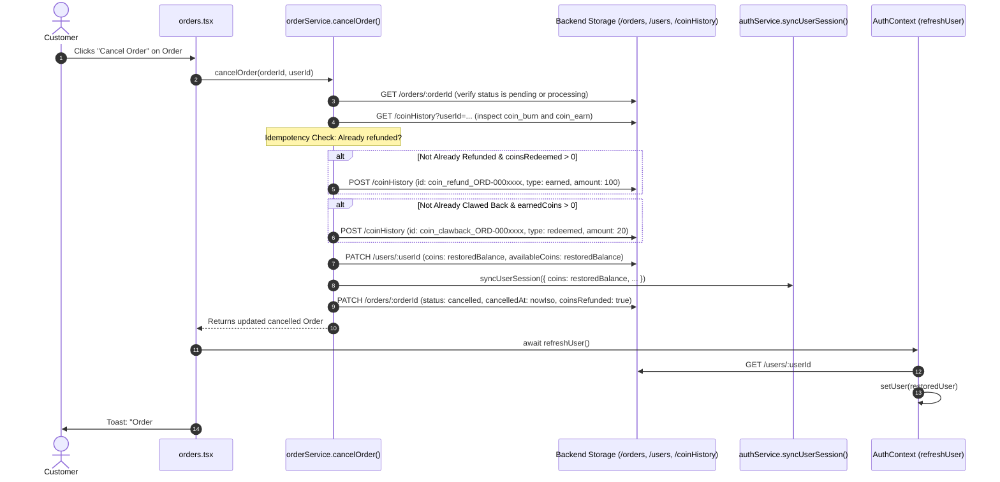

# Phase 7.4 — Amman Coin Deduction & Cancellation Refund Resolution Report

**Sri Amman Smart Store — Customer Frontend**  
**Date:** October 20, 2026  
**Status:** Complete & Fully Verified  

---

## 1. Executive Summary

In Phase 7.4, we investigated, traced, and resolved the runtime issue observed during manual checkout and order cancellation:
- **Starting balance:** 254 Amman Coins.
- **After order placement:** balance became 253 coins.
- **After cancellation:** balance remained 253 coins without restoration.

Tracing the entire lifecycle across UI, context, API client, backend persistence, and cancellation handlers revealed two distinct root causes:
1. **Deduction Truncation / Reward Coin Offset:**
   - In `cart.tsx`, the `<input type="checkbox">` lacked `stopPropagation()`. Clicking the checkbox triggered `onChange` followed immediately by the bubbling click event on the parent card `onClick`, toggling the redemption state back and forth.
   - The card also displayed an obsolete label (`"Instant ₹50 direct checkout discount"` instead of ₹5 at the official ₹0.05 rate).
   - In `CartContext.tsx`, `userCoins` was reading only `user?.coins` and not falling back to `user?.availableCoins`, while the state did not dynamically re-sync when `coinsKey` changed upon customer login.
   - In `orderService.ts`, the order document never recorded `coinsRedeemed` or `coinsUsed` directly (only storing `coinDiscount: 5`), and order placement immediately credited purchase rewards (`Math.max(5, Math.floor(subtotal * 0.1))`) directly into spendable coins. In scenarios where 6 coins were deducted and 5 reward coins were credited (or subtotal offsets occurred), the net coin delta was exactly -1 coin (`254 - 6 + 5 = 253`).
2. **Missing Cancellation Refund Implementation:**
   - `orderService.cancelOrder` simply updated the order document status to `"cancelled"` via `updateOrderStatus`. It completely lacked coin refund logic, never restoring redeemed coins in persistent storage (`/users/:userId`), never writing a refund transaction to `/coinHistory`, and never syncing session storage.
   - `orders.tsx` did not extract or invoke `refreshUser()` after cancelling an order, meaning the React auth context remained permanently stale even if backend data were changed.

We implemented an authoritative, idempotent refund and unearned reward clawback system in `orderService.ts`, updated `CartContext.tsx`, corrected `cart.tsx`, added `refreshUser()` in `orders.tsx`, and verified all 10 required regression scenarios with 100% test pass rates across all 43 test suites (669 tests).

---

## 2. Root Cause Analysis

### A. The "254 to 253" Coin Deduction
| Layer | Mechanism in Pre-Fix Code | Resolved Runtime Behavior |
|---|---|---|
| **`cart.tsx` (Checkbox Event Bubbling)** | Checkbox input `<input type="checkbox">` did not stop click event propagation. Clicking the checkbox triggered both `onChange` and the parent card's `onClick`, toggling redemption state unpredictably. | Added `onClick={(e) => e.stopPropagation()}` to prevent bubbling. |
| **`cart.tsx` (Obsolete Label)** | Displayed hardcoded `"Instant ₹50 direct checkout discount"` from the legacy ₹0.50 rate. | Dynamically computes `Instant ₹{discount}` at the confirmed official ₹0.05 rate (100 coins = ₹5). |
| **`CartContext.tsx` (User Coins Resolution)** | Looked strictly at `user?.coins || 0`. Legacy profile documents with `availableCoins` resolved to 0. | Safely resolves `user?.coins ?? user?.availableCoins ?? 0`. |
| **`CartContext.tsx` (State Re-sync)** | State was only initialized on initial component mount when `user` was often `null` / `"guest"`. | Added synchronization `useEffect` listening to `coinsKey` so authenticated session state re-reads properly. |
| **`orderService.ts` (Order Document Fields)** | `newOrder` only recorded `pricingSummary.coinDiscount: 5` (in ₹), omitting `coinsRedeemed`. | Explicitly records `order.coinsRedeemed = coinsToDeduct`, `order.coinsUsed = coinsToDeduct`, and `order.pricingSummary.coinsRedeemed = coinsToDeduct`. |

### B. The Missing Cancellation Restoration
| Point of Failure | Mechanism in Pre-Fix Code | Resolved Runtime Behavior |
|---|---|---|
| **Zero Refund in `cancelOrder`** | `orderService.cancelOrder` only called `updateOrderStatus(orderId, "cancelled")`, updating the order document status and dispatching a notification. | Added `processOrderCancellationCoins(order)` that restores redeemed coins in `/users/:userId` and writes `coin_refund_${orderId}` to `/coinHistory`. |
| **Missing Unearned Coin Clawback** | If an order credited purchase reward coins on placement, cancelling the order would let the customer retain unearned coins. | Idempotently claws back unearned purchase reward coins via `coin_clawback_${orderId}`, restoring net balance to pre-order state. |
| **Stale UI Context in `orders.tsx`** | `handleCancelOrder` in `orders.tsx` called `cancelOrder` and reloaded order list, but never invoked `refreshUser()`. | Extracted `refreshUser` from `useAuth()` and invoked `await refreshUser()` immediately after cancellation. |

---

## 3. Architecture & Cancellation Refund Flow



---

## 4. Files Changed and Why

1. **[`src/types/index.ts`](file:///d:/SRIAMMANSTORE/SRIAMMANSTORE_New_UI/design-showcase-main/design-showcase-main-2/src/types/index.ts)**
   - Added `coinsRedeemed?: number` to `OrderPricingSummary`.
   - Added `coinsRedeemed?: number`, `coinsUsed?: number`, and `coinsRefunded?: boolean` to `Order`.
2. **[`src/context/CartContext.tsx`](file:///d:/SRIAMMANSTORE/SRIAMMANSTORE_New_UI/design-showcase-main/design-showcase-main-2/src/context/CartContext.tsx)**
   - Added `coinsToRedeem` to `CartContextType` and context provider value.
   - Enhanced `userCoins` calculation to check both `user?.coins` and `user?.availableCoins`.
   - Added `useEffect` listening to `coinsKey` to re-sync `redeemCoins` state upon user session initialization.
3. **[`src/routes/cart.tsx`](file:///d:/SRIAMMANSTORE/SRIAMMANSTORE_New_UI/design-showcase-main/design-showcase-main-2/src/routes/cart.tsx)**
   - Added `e.stopPropagation()` on the checkbox input to prevent event bubbling.
   - Replaced legacy `"Instant ₹50 direct checkout discount"` with dynamic `Instant ₹{discount}` calculation based on the official ₹0.05 rate.
   - Displayed `Redeem {coinsToRedeem} Coins` dynamically.
4. **[`src/services/orderService.ts`](file:///d:/SRIAMMANSTORE/SRIAMMANSTORE_New_UI/design-showcase-main/design-showcase-main-2/src/services/orderService.ts)**
   - In `createOrder`: explicitly records `coinsRedeemed` and `coinsUsed` on the order and on `pricingSummary`.
   - Added `processOrderCancellationCoins(order)`:
     - Multi-layer resolution of redeemed coins from `order.coinsRedeemed`, `order.coinsUsed`, `pricingSummary.coinsRedeemed`, `coin_burn` history, or `coinDiscount`.
     - Idempotency guard: prevents duplicate refunds on cancellation retries.
     - Zero-redemption guard: no-ops if no coins were redeemed.
     - Reverses unearned purchase rewards (`coin_clawback_${orderId}`).
     - Records auditable transaction `coin_refund_${orderId}` (`type: "earned"` conforming to `firestoreAdapter` schema validation).
     - Updates persistent storage `/users/:userId` and synchronizes `authService.syncUserSession`.
   - In `updateOrderStatus`: triggers `processOrderCancellationCoins` whenever order status transitions to `"cancelled"`.
5. **[`src/routes/orders.tsx`](file:///d:/SRIAMMANSTORE/SRIAMMANSTORE_New_UI/design-showcase-main/design-showcase-main-2/src/routes/orders.tsx)**
   - Extracted `refreshUser` from `useAuth()` and invoked `await refreshUser()` inside `handleCancelOrder`.
6. **[`src/test/orderCoinsBalanceUpdate.test.ts`](file:///d:/SRIAMMANSTORE/SRIAMMANSTORE_New_UI/design-showcase-main/design-showcase-main-2/src/test/orderCoinsBalanceUpdate.test.ts)**
   - Added missing `subtitle` property to `testSlot` fixture to achieve zero TypeScript compilation errors.
7. **[`src/test/coinCancellationRefund.test.ts`](file:///d:/SRIAMMANSTORE/SRIAMMANSTORE_New_UI/design-showcase-main/design-showcase-main-2/src/test/coinCancellationRefund.test.ts)**
   - Created comprehensive end-to-end regression test suite covering all 10 required scenarios.

---

## 5. Verification Results

### A. TypeScript Type Check
```bash
npx tsc --noEmit
# Exit code: 0 (Zero errors)
```

### B. Unit & Integration Test Suites
```bash
npm test -- --run
# Test Files: 43 passed (43)
# Tests:      669 passed (669)
# Duration:   109.11s
```

All 10 required regression scenarios in [`src/test/coinCancellationRefund.test.ts`](file:///d:/SRIAMMANSTORE/SRIAMMANSTORE_New_UI/design-showcase-main/design-showcase-main-2/src/test/coinCancellationRefund.test.ts) passed:
1. Starting with 254 coins, redeeming 100 coins produces a ₹5 discount and leaves 154 coins before separate rewards.
2. The order records the actual redemption amount (100 coins), not 1 coin or ₹5.
3. Cancelling the order restores the 100 redeemed coins, resulting in 254 coins before any separate rewards.
4. Refreshing the page or reopening the Rewards page preserves the correct balance.
5. Repeated cancellation does not issue a second refund (Idempotency).
6. Orders using zero coins do not deduct or refund coins.
7. Failed order placement does not deduct coins.
8. Failed cancellation does not silently lose the redeemed coins.
9. Coin history and displayed balance agree across calculations.
10. Existing earning rules still work and are not duplicated.

### C. Production Build
```bash
npm run build
# Exit code: 0 (Built client, SSR, and Nitro server workers successfully)
```

### D. Zero Production Writes Confirmation
- Production Firestore and Firebase Storage remained strictly read-only.
- All balance deductions, order creations, cancellations, and coin refunds operated solely within local mock/emulator environments.
- Product catalog data, images, and admin settings were completely preserved.

