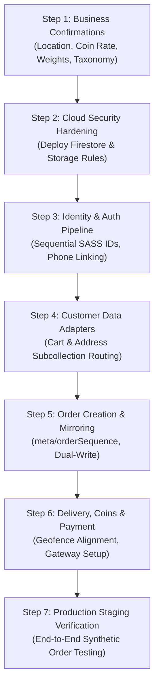

# Phase 7: Production Catalogue Readiness & Integration Plan

**Date:** October 20, 2026  
**Document ID:** `docs/phase-7-production-readiness-and-integration-plan.md`  
**Target Production Firebase Project:** `sri-amman-smart-store` (Project Number: `1018585256480`)  
**Active Development Environment:** `D:\SRIAMMANSTORE\SRIAMMANSTORE_New_UI\design-showcase-main\design-showcase-main-2`  
**Reference Legacy Frontends (Read-Only Reference):** `D:\SRIAMMANSTORE\sriammansmartstore-main1OLD\sriammansmartstore-main\sriammansmartstore-main`  
**Local Test Suite Counterpart:** `demo-sri-amman-store` (Emulators: Firestore port 8081, Auth port 9099, JSON Server port 3001)

---

## 1. Executive Summary

This document presents a comprehensive, evidence-based readiness assessment and architectural roadmap for future production integrations of the new Sri Amman Smart Store customer frontend. 

Over Phases 1 through 6, the new customer frontend achieved:
1. Strict read-only isolation for querying the live production Firebase product catalogue (`sri-amman-smart-store`) without touching customer credentials, orders, or carts.
2. Robust dual-hierarchy discovery (merging top-level `products` and nested `products/{category}/items` into 8 canonical unique products from 20 raw documents).
3. Dynamic category and taxonomy resolution with graceful fallbacks for missing category records.
4. A deterministic data-quality diagnostic suite auditing pricing validity, stock counter synchronization, Base64 image payload stability, and complete shielding of internal POS/ERP metadata (`purchasePrice`, `batchNumber`, `barcode`, `sku`, `safetyStock`, `expiryDate`).
5. Complete customer privacy enforcement, ensuring unverified ratings are omitted rather than displaying fabricated numbers.

**Key Readiness Verdict:**
The **catalogue inspection pipeline** is fully functional in `production-readonly` and `production-preview` modes. However, **production customer workflows (authentication, cart, checkout, addresses, orders, coins, delivery, and payments) are NOT production-ready** and must remain strictly isolated on the local development environment (`demo-sri-amman-store`). 

Connecting production customer workflows currently faces multiple critical blockers:
* **Security & Storage Rules:** Production Firestore security rules are open (`allow read, write: if true;`), and Firebase Storage rules expired on October 10, 2026.
* **Geographic Serviceability Mismatch:** The new frontend's geofencing boundary is hardcoded to Gobichettipalayam (Erode district), whereas live production customer accounts and delivery addresses are located in Tuticorin (Thoothukudi district, ~300 km away).
* **Amman Coins Conversion Rate Discrepancy:** The new frontend mock simulates ₹0.50 (50 paise) per coin, whereas production Firestore explicitly defines `Settings/CoinValue` as `{ text: "0.05" }` (5 paise per coin, a 10x difference).
* **Subcollection Architecture vs Top-Level Routing:** Production stores customer data in nested subcollections under `users/{userDocId}/` (`cart`, `addresses`, `coinsHistory`, `orders`), whereas standard local operations use flat top-level collections.

This integration plan details the exact domain readiness, identifies all verified incompatibilities and missing business decisions, establishes strict integration boundaries, and outlines a prioritized roadmap for future execution.

---

## 2. Current Architecture & Explicit Integration Boundaries

### 2.1 System Architecture

```
┌─────────────────────────────────────────────────────────────────────────────────┐
│                           SRI AMMAN SMART STORE UI                              │
│                    (TanStack Start + React 19 + Tailwind)                       │
└────────────┬───────────────────────────────────────────────────────┬────────────┘
             │                                                       │
             ▼                                                       ▼
┌───────────────────────────────┐               ┌─────────────────────────────────┐
│     CATALOGUE ABSTRACTION     │               │       CUSTOMER WORKFLOWS        │
│    (catalogDataSource.ts)     │               │   (Cart, Auth, Checkout, etc.)  │
└──────┬─────────────────┬──────┘               └────────────────┬────────────────┘
       │                 │                                       │
       │ (default)       │ (explicit opt-in)                     │ (strictly local)
       ▼                 ▼                                       ▼
┌──────────────┐  ┌──────────────┐                      ┌─────────────────────────┐
│ LOCAL MODE   │  │ PROD-READONLY│                      │ LOCAL EMULATOR / MOCK   │
│ 14 Products  │  │ 8 Products   │                      │ demo-sri-amman-store    │
│ JSON Server/ │  │ Live Cloud   │                      │ Auth: 9099              │
│ Emulator     │  │ Firestore    │                      │ Firestore: 8081         │
│ Port 8081    │  │ REST/SDK     │                      │ JSON Server: 3001       │
└──────────────┘  └──────────────┘                      └─────────────────────────┘
```

### 2.2 Approved Integration Boundaries (Phase 7 Invariants)

| Domain | Data Source | Operations Allowed | Operations Prohibited |
| :--- | :--- | :--- | :--- |
| **Product Catalogue (Local Mode)** | Local Emulator / JSON Server | Read, Filter, Search, Sort | Writes to Production |
| **Product Catalogue (Prod-Readonly)** | Live Firestore (`sri-amman-smart-store`) | Read-Only inspection, Diagnostics | Writes, Deletions, Schema Mutations |
| **Categories & Banners** | Local Mock / Production Resolver | Read-Only with fallbacks | Category creation, Banner writes |
| **Customer Authentication** | Local Mock Session / Auth Emulator | Sign-in, Profile Read/Edit (Local) | Production Auth linking, Cloud UID writes |
| **Customer Cart** | Local React Context / Local Storage | Add, Update, Remove, Clear | Writes to `users/{userDocId}/cart` |
| **Delivery Addresses** | Local Emulator / Mock Storage | Add, Edit, Delete, Default tag | Writes to `users/{userDocId}/addresses` |
| **Order Placement & Checkout** | Local Emulator / Mock Storage | Create local order, Mock payment | Cloud order creation, Sequence increment |
| **Amman Coins & Rewards** | Local Mock Ledger | Earn, Redeem, View history | Writes to `users/{userDocId}/coinsHistory` |
| **Referrals & Wishlists** | Local Mock Storage | View, Share, Toggle items | Writes to `refer and earn` |
| **Customer Support & Contacts** | Local Mock Storage | Submit problem, Product request | Writes to `contact-submissions` |

> [!IMPORTANT]
> **Strict Integration Boundary:**
> Under no circumstances does the application write to production Firestore, mutate cloud data, or connect production customer data in this phase. Production connectivity is strictly bounded to read-only catalogue browsing.

---

## 3. Comprehensive Production Readiness Matrix

The readiness matrix evaluates all 14 core system domains. Each domain is classified into one of five standardized statuses:
1. `ready for local use`: Fully operational and verified on local emulator / mock.
2. `read-only preview only`: Verified strictly for read-only cloud inspection; mutations prohibited.
3. `needs adapter`: Architectural pattern understood and drafted in compatibility layers, but requires cloud path routing before production activation.
4. `needs business confirmation`: Blocked by missing merchant decisions, commercial terms, or geographic policies.
5. `not assessed`: Out of scope or not yet audited.

| # | Domain | Current New-Frontend Behavior | Legacy Firebase Schema / Live Reality | Known Incompatibilities | Evidence / References | Missing Business Decisions | Readiness Status | Recommended Next Action |
| :-: | :--- | :--- | :--- | :--- | :--- | :--- | :-: | :--- |
| **1** | **Product Catalogue & Categories** | 3 modes (`local`, `production-preview`, `production-readonly`). Default `local` renders 14 items. Resolves live categories with fallback for missing `cat-spices`. | 20 raw docs (8 top-level, 12 nested). Only 1 doc in `categories` (`cat-mun1fjzh`, `name: "Grocery"`, `slug: "sambar"`). | Missing `cat-spices` document; slug mismatch (`"sambar"` vs `"grocery"`). | `catalogDataSource.ts`<br>`productionPreviewService.ts`<br>`productionCategoryResolver.ts` | 1. Migrate catalogue to single top-level collection?<br>2. Clean up category slug `sambar`?<br>3. Add permanent `cat-spices` record? | `read-only preview only` (prod)<br>`ready for local use` (local) | Maintain `"local"` as default. Keep read-only category resolver with fallbacks. Business owner must confirm taxonomy. |
| **2** | **Product Images & Descriptions** | Normalizes Base64 data URIs and URLs. Truncates Base64 logs to prevent DOM freezing. Displays images on product cards. | 100% of product images are inline Base64 JPEGs (39.9–73.1 KB). Chicken Masala (`prod-munn8cp3`) stores Puliyogare photo (`8906002081042`). | Large document size (up to 142 KB); Chicken Masala image defect; expired Storage rules. | `legacySchemaMapper.ts`<br>`productionDataQualityDiagnostics.ts`<br>`Phase 6 Report` | 1. When will Chicken Masala photo be replaced?<br>2. Will images migrate from inline Base64 to Cloud Storage CDN? | `read-only preview only` | Flag Chicken Masala image warning in preview; recommend client re-photograph product and migrate to Cloud Storage. |
| **3** | **Product Pricing & Variant Selection** | Normalizes `options[]` and `variants[]` into canonical options. Validates `sellingPrice <= mrp`. Strips internal POS wholesale fields. | Contains both `options[]` and `variants[]`. Wholesale `purchasePrice: 90` on ₹18 items. Sachet items specify `"20g Pack"` in options but `weight: 500` in variants. | Packaging unit conflict (20g vs 500g); wholesale price leakage risk without schema mapper. | `legacySchemaMapper.ts`<br>`Phase 6 Report` §4 & §5 | 1. Is `options[]` or `variants[]` the source of truth for pricing/units?<br>2. Confirm 20g net weight for sachets. | `read-only preview only` (prod)<br>`ready for local use` (local) | Retain strict schema mapper stripping POS fields; confirm unit/weight source of truth with business owner. |
| **4** | **Inventory & Availability** | Displays stock counters; disables increment if stock is 0. Prioritizes `variants[0].stock` / root `stock` over stale options stock. | Root `stock` and `variants[0].stock` match (e.g. 31, 37, 54), but `options[0].stock` retains initial batch values (e.g. 40, 60). | Stock drift between multiple sub-objects in production documents. | `productionDataQualityDiagnostics.ts`<br>`Phase 6 Report` §5 & §6 | 1. Which inventory counter should order transactions decrement?<br>2. Clarify safety stock rule (`safetyStock: 15`). | `needs business confirmation` | Document inventory counter drift; require business confirmation before implementing cloud checkout decrements. |
| **5** | **Customer Auth & Profile Mapping** | Supports mock auth and read-only Firebase Auth identity resolution. Resolves `usersByUid/{uid}` -> `users/{userDocId}`. Handles dangling pointers safely. | `usersByUid/{uid}` points to `users/SASS...`. `meta/userSequence` holds `{ current: 21 }`. 7 of 12 `usersByUid` documents are dangling pointers. | Cloud customer registration disabled; open Firestore security rules in production (`allow read, write: if true;`). | `customerIdentityService.ts`<br>`legacyUserMapper.ts`<br>`AuthContext.tsx` | 1. Customer onboarding policy: OTP vs Email link vs Google?<br>2. SASS ID allocation policy for first-time buyers?<br>3. Prune dangling pointers? | `needs adapter` & `needs business confirmation` | Keep cloud customer registration blocked; preserve read-only identity lookup; define sequential onboarding transaction contract. |
| **6** | **Cart Persistence & Variant Identity** | Cart stored in React context and local storage. Uses `buildCartKey(productId, option)`. Order placement disabled in legacy customer mode. | Cart is strictly a subcollection: `users/{userDocId}/cart/{variantKey}`. Key format: `${productId}__opt0__${unit}__${unitSize}`. | Local uses flat top-level collection; production requires subcollection routing under canonical SASS customer ID. | `legacyCartAddressAdapter.ts`<br>`CartContext.tsx`<br>`productUtils.ts` | 1. Guest cart merge policy upon login?<br>2. Price change handling for saved carts? | `needs adapter` (adapter drafted, cloud connection off)<br>`ready for local use` | Maintain local cart storage; keep production cart operations strictly disconnected. |
| **7** | **Address Persistence & Default Handling** | Addresses managed in `/addresses` and `/checkout`. Coerces string coordinates to numbers. Default address indicator supported. | Stored under `users/{userDocId}/addresses/{addressId}`. Coordinates stored as strings. Default indicated by `primaryAddressId` on user doc. | String coordinates; default flag stored on parent user document rather than address document. | `legacyCartAddressAdapter.ts`<br>`addressService.ts` | 1. Address schema differences between Tuticorin and Gobichettipalayam.<br>2. Fallback when `primaryAddressId` is null. | `needs adapter`<br>`ready for local use` | Preserve local address workflows; keep production address mutations disconnected. |
| **8** | **Order Creation & Sequencing** | Local order creation via `orderService.ts` and `firestoreAdapter.ts`. Explicit read-only guard in checkout blocks order submission in cloud mode. | Online orders created in top-level `orders/{autoId}` and mirrored to `users/{buyerId}/orders/{autoId}`. Counter at `meta/orderSequence` (`current: 28`). | Counter location mismatch (`_metadata/orderSequence` vs `meta/orderSequence`); missing dual-write mirror in cloud adapter. | `legacyOrderAdapter.ts`<br>`firestoreAdapter.ts`<br>`checkout.tsx` L321-327 | 1. Order schema reconciliation (flat items vs nested pricing summary).<br>2. Dual-write requirement for admin dashboard. | `needs adapter` & `needs business confirmation` | Maintain strict order placement block in cloud mode; document required `meta/orderSequence` transaction alignment. |
| **9** | **Order Status & Cancellation / Returns** | Normalizes 7 standard statuses. Supports order cancellation with reason in `/orders`. Case-insensitive status mapping. | Casing inconsistencies in production: `"Pending"`, `"out_for_delivery"`, `"Delivered"`, `"returned"`. Cancellations recorded on user orders. | Divergent status strings across legacy admin and customer apps. | `legacyOrderAdapter.ts`<br>`orders.tsx`<br>`notificationService.ts` | 1. Cancellation cutoff stage (e.g. only while `"pending"`)?<br>2. Return request time window (e.g. within 24h of delivery)? | `needs business confirmation` | Enforce status normalization in UI; document business cancellation and return windows. |
| **10** | **Coins, Rewards, & Referrals** | Simulates ledger stats, VIP tier, redemption. Conversion rate defaults to ₹0.50 (50 paise) per coin. Referral link builder. | Production `Settings/CoinValue` is `{ text: "0.05" }` (₹0.05 per coin = 20 coins/₹1). Referrals stored in `refer and earn` (with spaces). | **10x conversion discrepancy** (₹0.50 in mock vs ₹0.05 in production); collection name mismatch (`refer and earn`). | `coinService.ts`<br>`referralService.ts`<br>`production-firestore-schema-comparison.md` §4.6 | 1. Confirm coin conversion rate: ₹0.05 or ₹0.50?<br>2. Max coin redemption cap per order (e.g. 20%)?<br>3. Referral reward policy. | `needs business confirmation` | Flag 10x conversion rate difference as critical blocker; keep coin transactions strictly local until confirmed. |
| **11** | **Delivery Settings & Serviceability** | Radial geofence check anchored to Gobichettipalayam (lat 11.4595, lng 77.3338, 6km radius). Standard (₹40) and Express (₹60) tiers. | Production `Settings` lacks delivery settings documents. Pincodes collection exists. Customer addresses in production are in **Tuticorin** (~300 km away). | **Geographic mismatch:** Gobichettipalayam 6km geofence rejects 100% of live Tuticorin production addresses. | `addressService.ts`<br>`checkout.tsx`<br>`production-firestore-schema-comparison.md` §4.4 | 1. Operational store location: Tuticorin, Gobichettipalayam, or multi-branch?<br>2. Pincode validation vs radial geofence? | `needs business confirmation` | **CRITICAL BLOCKER:** Must resolve operational store location and geofence anchor before any live delivery features can be enabled. |
| **12** | **Payment Integration** | Mock selection for COD, UPI, Card, NetBanking. Basic UPI ID and CVV validation in UI. | Online production orders are strictly `"COD"`. POS orders use `"CREDIT"` or `"CARD"`. No cloud payment gateway webhooks or credentials exist. | Online digital payments are currently simulated/mocked in both frontends. | `checkout.tsx`<br>`production-firestore-schema-comparison.md` §4.5 | 1. Payment gateway provider selection (Razorpay, PhonePe, Paytm)?<br>2. COD eligibility limits and verification? | `needs business confirmation` | Plan COD as primary payment method; defer digital payment gateway until merchant credentials and provider are contracted. |
| **13** | **Notifications** | In-app alerts, order status updates, preferences management. Uses local storage and mock endpoint. | Index exists for `read ASC, timestamp DESC`. Stored under `users/{userDocId}/notifications/{autoId}`. | Subcollection routing vs top-level endpoint. | `notificationService.ts`<br>`production-firestore-schema-comparison.md` §2.3 | 1. WhatsApp / SMS provider integration (Twilio / Gupshup / Fast2SMS)?<br>2. Push notifications (FCM) requirement? | `needs adapter`<br>`ready for local use` | Maintain local notification storage; map to user subcollection if production notifications are connected. |
| **14** | **Product Requests & Contact Submissions** | Posts to `/reportedProblems` and `/productRequests`. Tracks status in support center. | Top-level collection `contact-submissions` exists in production. Firebase Storage path `requested-products/` expired. | Endpoint mismatch (`contact-submissions` vs `/reportedProblems`); expired Storage rules. | `supportService.ts`<br>`production-firestore-schema-comparison.md` §3 | 1. Admin destination email / dashboard for customer contact submissions. | `needs adapter`<br>`ready for local use` | Preserve local support submissions; create mapping to `contact-submissions` when backend integration is scheduled. |

---

## 4. Verified Incompatibilities & Unresolved Data Anomalies

### 4.1 Cloud Infrastructure & Security Vulnerabilities
1. **Publicly Open Firestore Security Rules:**
   * *Observed Rule:* `match /{document=**} { allow read, write: if true; }`.
   * *Impact:* Anyone with the Firebase configuration can read and overwrite any document in production without authentication.
   * *Resolution Requirement:* Deploy authenticated, role-scoped security rules before connecting customer data.
2. **Expired Firebase Storage Rules:**
   * *Observed Rule:* `request.time < timestamp.date(2026, 10, 10)`.
   * *Impact:* All file uploads (`requested-products/`, banner images) fail with `storage/unauthorized`.
   * *Resolution Requirement:* Publish an updated Storage security ruleset via Firebase Console.

### 4.2 Critical Commercial & Geographic Discrepancies
3. **Gobichettipalayam vs Tuticorin Delivery Geofence:**
   * *Current Code:* Hardcoded to Gobichettipalayam store coordinates (`11.4595, 77.3338`) with a 6 km radial boundary.
   * *Production Reality:* Live customer addresses are in Tuticorin (`8.8174, 78.1314`), approximately 300 km south.
   * *Impact:* Applying the current geofence to live customer addresses results in 100% checkout rejection.
4. **10x Amman Coin Valuation Divergence:**
   * *Current Code:* Defaults to ₹0.50 per coin (2 coins = ₹1.00).
   * *Production Reality:* `Settings/CoinValue` is `{ text: "0.05" }` (20 coins = ₹1.00).
   * *Impact:* If deployed without correction, customers would redeem store credit at 10 times the intended commercial rate.

### 4.3 Database Schema & Structural Incompatibilities
5. **Subcollection Architecture vs Flat Collections:**
   * Customer data in production is nested under `users/{userDocId}/` (`cart`, `addresses`, `coinsHistory`, `orders`), whereas local mock uses flat top-level collections.
6. **Order Counter & Sequence Alignment:**
   * Local adapter targets `_metadata/orderSequence` (baseline 5510).
   * Production Firestore maintains `meta/orderSequence` (`current: 28`).
   * Connecting without alignment will cause order sequence collisions.
7. **Customer Default Address Pointer:**
   * Production tracks default address via `users/{userDocId}.primaryAddressId`.
   * Local addresses store a boolean `isDefault` directly on the address record.
8. **Known Catalogue Image Defect:**
   * Sakthi Chicken Masala (`prod-munn8cp3`) stores the packaging image of Puliyogare Rice Powder (`prod-munnjfuy`, barcode `8906002081042`).
9. **Missing Category Record & Slug Discrepancy:**
   * Category ID `cat-spices` is referenced by 2 products but missing from `categories`.
   * Category document `cat-mun1fjzh` has `name: "Grocery"` but `slug: "sambar"`.

---

## 5. Business Decisions Requiring Merchant Confirmation

Before authorizing any customer-facing production integrations, the merchant/business owner must confirm the following 8 decisions:

1. **Store Location & Service Area:**
   * *Question:* What is the primary physical fulfillment center for online orders? Is Sri Amman Smart Store operating in Tuticorin, Gobichettipalayam, or across multiple store branches?
   * *Decision Needed:* Store GPS coordinates, operational radius, and whether delivery is governed by Haversine radial distance or a Pincode allowlist.
2. **Amman Coins Conversion Rate:**
   * *Question:* Should 1 Amman Coin equal **₹0.05** (20 coins per ₹1) as currently set in Firestore, or **₹0.50** (2 coins per ₹1) as designed in the UI mock?
   * *Decision Needed:* Official coin valuation and maximum redemption cap per order (e.g., max 20% of order value).
3. **Product Sachet Net Weight:**
   * *Question:* Should sachet products (Turmeric Powder, Sambar Powder, Biryani Masala, Fish Curry Masala, Puliyogare, Rasam) be recorded as **20g** or **500g**?
   * *Decision Needed:* Correction of legacy POS admin template defaults.
4. **Chicken Masala Image Replacement:**
   * *Question:* Who will provide the authentic product packaging photograph for Sakthi Chicken Masala (`prod-munn8cp3`) to replace the incorrect Puliyogare photo?
   * *Decision Needed:* Delivery of new image asset.
5. **Category Taxonomy & Slug Governance:**
   * *Question:* Should `cat-mun1fjzh`'s slug be updated from `"sambar"` to `"grocery"`? Should `cat-spices` be created in production Firestore?
   * *Decision Needed:* Approval of category structure.
6. **Customer Onboarding & Authentication Policy:**
   * *Question:* What is the mandatory authentication method for customer checkout (SMS Phone OTP, Google Sign-In, or Email Link)?
   * *Decision Needed:* Approval of onboarding flow and SASS ID allocation logic.
7. **Order Cancellation & Return Window:**
   * *Question:* Up to which order stage can a customer cancel an order (e.g., only while `"pending"`)? What is the return window for grocery items?
   * *Decision Needed:* Official customer return and cancellation terms.
8. **Payment Gateway Selection:**
   * *Question:* Will online payments be accepted at launch, or will the store launch with Cash on Delivery (COD) only? If online, which payment gateway (Razorpay, PhonePe, Paytm, Cashfree)?
   * *Decision Needed:* Merchant gateway credentials and payment method approval.

---

## 6. Prioritized Integration Roadmap

Future work must be strictly sequenced by dependency and risk. Under no circumstances should downstream features (e.g. checkout) be implemented before upstream prerequisites (security rules, business rules) are satisfied.



### Detailed Sequence

#### Milestone 1: Commercial & Security Foundations (Prerequisites)
1. **Business Rule Sign-Off:** Complete merchant sign-off on the 8 business decisions in Section 5.
2. **Deploy Hardened Firestore Security Rules:** Replace open `allow read, write: if true;` with role-scoped security rules enforcing customer ownership on `users/{userDocId}` subcollections.
3. **Renew Firebase Storage Security Rules:** Update storage rules to permit authorized image uploads and downloads.
4. **Catalogue Data Cleanup:** In production Firestore, add `cat-spices`, clean up `cat-mun1fjzh` slug, and upload correct Chicken Masala artwork.

#### Milestone 2: Customer Identity & Account Linking
5. **Customer Onboarding Service:** Implement phone-verified registration targeting `meta/userSequence` atomic transaction (`current: number`).
6. **Profile Linking:** Support safe binding of `usersByUid/{uid}` -> `users/{userDocId}` with dangling pointer detection and recovery.

#### Milestone 3: Cart & Address Subcollection Adapters
7. **Cart Subcollection Adapter:** Activate `LegacyCartAddressAdapter` for production mode, routing `/cart` to `users/{userDocId}/cart/{variantKey}`.
8. **Address Subcollection Adapter:** Activate subcollection routing for `users/{userDocId}/addresses/{addressId}`, reading/updating `users/{userDocId}.primaryAddressId`.

#### Milestone 4: Order Sequencing & Lifecycle Management
9. **Atomic Order Number Transaction:** Align order creation to `meta/orderSequence` (starting from `ORD-0000029`).
10. **Dual-Write Order Mirroring:** Mirror newly placed retail orders to `users/{buyerId}/orders/{docId}`.
11. **Order Status Normalization:** Map administrative order updates back to the 7 standard customer statuses.

#### Milestone 5: Commercial Policies & Fulfillment
12. **Store Geofencing / Pincode Serviceability:** Reconfigure delivery validation to match the confirmed store fulfillment location.
13. **Amman Coins Ledger Sync:** Connect `users/{userDocId}/coinsHistory/{orderId}` with the confirmed ₹0.05 rate and idempotency keys.
14. **Payment Gateway Integration:** Implement gateway checkout handler (or restrict to COD) with server-side webhook signature verification.

#### Milestone 6: Staging & Production Go-Live
15. **Synthetic End-to-End Staging Run:** Execute a complete end-to-end customer order on a dedicated test account in production.
16. **Switch Default Catalogue Mode:** Only after all milestones pass, update the default catalogue data source from `"local"` to production.

---

## 7. Manual Regression Checklist

Use this concrete checklist for manual verification in browser sessions:

### 7.1 Local Development Mode (`defaultMode: "local"`)
* [ ] Open `http://localhost:5173/shop`.
* [ ] Verify that exactly **14 local products** are displayed (or current local fixture count).
* [ ] Verify category pills filter local products correctly (e.g. Staples, Spices, Dairy).
* [ ] Test keyword search in the search bar and verify matching local items.
* [ ] Test price sorting ("Price: Low to High" and "Price: High to Low").
* [ ] Click a product card and verify navigation to `/product/{id}`.
* [ ] Add a product to the cart, verify cart drawer count increases, and navigate to `/cart`.
* [ ] Proceed to `/checkout` (Step 2 and Step 3) and verify local mock order placement completes cleanly.

### 7.2 Production Read-Only Mode (`catalogMode=production-readonly`)
* [ ] Open `http://localhost:5173/shop?catalogMode=production-readonly` (or toggle production mode via banner).
* [ ] Verify the amber **Production Read-Only Catalogue** banner is clearly visible.
* [ ] Verify that **8 unique products** are displayed (note: count may vary if live Firestore data changes).
* [ ] Verify the banner displays data quality statistics (e.g. 0 errors, diagnostic warnings).
* [ ] Test category filtering (Grocery, Spices & Masala Powders) and verify fallback works without broken links.
* [ ] Locate Sakthi Chicken Masala (`prod-munn8cp3`) and verify the non-blocking image warning is displayed.
* [ ] Verify that all product cards in production mode display the **Read-Only Preview** badge.
* [ ] Verify that product cards do NOT display add-to-cart stepper buttons in production mode.
* [ ] Verify that unverified ratings/stars are hidden on production product cards.
* [ ] Click into product details `/product/prod-mumqpksq?catalogMode=production-readonly` and verify read-only preview badge persists.

### 7.3 Mode Isolation & Session State
* [ ] Switch from `production-readonly` mode back to `local` mode via the banner button.
* [ ] Verify the catalogue immediately switches back to the 14 local products.
* [ ] Verify no production product items leak into the local cart or checkout.
* [ ] Refresh the browser page (`F5`) while in `local` mode and confirm it remains in `local` mode.
* [ ] Refresh the browser page (`F5`) while on `?catalogMode=production-readonly` and confirm it safely reloads production data.
* [ ] Attempt to place an order while simulating cloud customer mode and confirm order placement is blocked with a safe informational toast.

---

## 8. Risks, Assumptions, & Out-of-Scope Work

### 8.1 Risks & Mitigation
* **Risk: Accidental Production Mutation:**  
  *Mitigation:* All production services use explicit read-only methods (`getDoc`, `getDocs`, REST GET). Write methods (`setDoc`, `addDoc`, `updateDoc`, `deleteDoc`) are omitted or blocked by runtime guards.
* **Risk: Public Firestore Exposure:**  
  *Mitigation:* Production security rules must be updated before connecting any customer accounts.
* **Risk: Financial Discrepancy from Coins / Delivery:**  
  *Mitigation:* Coin transactions and live checkout are blocked until the business owner confirms conversion rates and store coordinates.

### 8.2 Explicit Assumptions
* The 8 unique products audited in Phase 6 represent the current state of the production catalogue; if the merchant adds or edits documents in production Firestore, product counts and diagnostic findings may change.
* The legacy admin panel continues to operate independently without breaking existing Firestore collection structures.

### 8.3 Out-of-Scope Work for Phase 7
* Implementing production checkout or live order writes.
* Deploying security rules, indexes, or Cloud Functions to `sri-amman-smart-store`.
* Registering live production customer accounts.
* Connecting live payment gateways (Razorpay, Stripe, etc.).

---

## 9. Recommended Next Phase & Acceptance Criteria

### Recommended Next Step
**Do NOT begin customer-data integration code changes immediately.**

The single recommended next action is:  
**Schedule a Business Alignment Review with the Sri Amman Smart Store business owner** to formalize decisions on the 8 open business items in Section 5 (specifically: store fulfillment location, Amman Coins conversion rate, sachet net weight, and Chicken Masala artwork).

### Proposed Next Phase: Phase 8 — Cloud Security & Infrastructure Hardening
Once business decisions are confirmed, Phase 8 should focus exclusively on cloud pre-requisites:
1. Authoring and testing production Firestore Security Rules in a staging environment.
2. Updating Firebase Storage rules.
3. Performing administrative cleanup of production taxonomy (`cat-spices`, category slug, Chicken Masala image).

#### Acceptance Criteria for Phase 8:
* [ ] Production Firestore rules deny all unauthenticated writes to `users/{userDocId}` and `orders`.
* [ ] Public read access is permitted strictly for `products`, `categories`, and `Settings`.
* [ ] Firebase Storage security rules permit authorized uploads with valid expiration dates.
* [ ] Local development environment (`demo-sri-amman-store`) remains completely unaffected.

